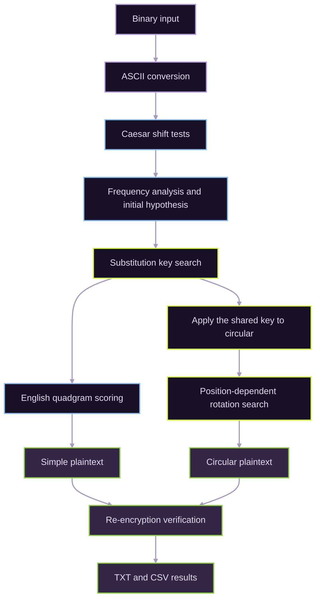

# Cryptanalysis in Python

**Binary decoding · Classical ciphers · Frequency analysis · Heuristic key search**

[](README.pt-BR.md) [](#methodology) [](#results) [](#running-the-project)

A Python project developed for **Computer Architecture (MCTA004-17)** at the **Federal University of ABC (UFABC)**. The assignment involved recovering two messages encoded as binary ciphertexts and identifying their underlying transformations.

## Investigation workflow



## Methodology

| Stage | Approach |
| --- | --- |
| Binary decoding | Convert space-separated binary numbers into ASCII characters |
| Caesar cipher | Inspect all 26 fixed shifts for both ciphertexts |
| Frequency analysis | Count letters and examine repeated patterns |
| Substitution cipher | Hill climbing with randomized key swaps and 10 restarts |
| Language scoring | Rank candidates using English quadgram frequencies |
| Circular cipher | Evaluate 1,352 rotation combinations with position-dependent shifts |
| Verification | Re-encrypt both recovered messages and compare them with the inputs |

The initial manual hypothesis included `V → T`, `C → H`, `O → E`, and `T → A`. The automated substitution search did not use these correspondences as fixed constraints.

## Results

| Metric | Simple | Circular |
| --- | ---: | ---: |
| Text length | 2,128 characters | 448 characters |
| Letters evaluated | 1,697 | 370 |
| Candidates evaluated | 38,259 keys | 1,352 rotations |
| Best quadgram score | −7,018.9629 | −1,526.7593 |
| Average per quadgram | −4.14 | −4.16 |
| Search time (single run) | 24.118 s | 0.590 s |
| Re-encryption matched input | Yes | Yes |

Eight of ten substitution-search restarts converged to the selected key. For `circular`, the best-scoring transformation used **start = 12**, **step = 1**, and letter-only position counting. The texts were also evaluated for readability and cross-consistency; re-encryption alone checks the coherence of the inverse transformations, not the unique correctness of a key.

Detailed outputs: [results summary](resultados/10_resumo.txt) · [key mapping](resultados/05_simple_chave.csv) · [search history](resultados/05_simple_evolucao.csv) · [rotation ranking](resultados/08_circular_ranking.csv).

## Project structure

```text
.
├── main.py                 # Execution workflow
├── binario.py              # Binary conversion
├── cesar.py                # Caesar shifts
├── substituicao.py         # Frequency and substitution-key search
├── pontuacao.py            # Quadgram scoring
├── circular.py             # Position-dependent rotations
├── dados/
│   ├── entrada/            # Ciphertext inputs
│   └── referencia/         # Language statistics
├── resultados/             # Generated TXT/CSV results
├── README.md
└── README.pt-BR.md
```

## Running the project

**Requirements:** Python 3; standard library only.

From the project directory, run:

```bash
python main.py
```

The script reads both files in `dados/entrada/` and the quadgram table in `dados/referencia/`, prints progress in Portuguese and generates the `resultados/` files. A fixed random seed (42) supports reproducibility; execution times depend on the environment.

## Scope and limitations

- Educational cryptanalysis of **classical ciphers**, not a modern cryptographic security application.
- English quadgram scoring is heuristic and depends on the chosen reference corpus.
- The reported runtime and convergence counts refer to the assignment's recorded execution, not a benchmark across machines or datasets.
- Program identifiers, messages and output filenames remain in Portuguese to preserve the original academic submission.

## References and academic context

The English quadgram reference data is credited to [Lucian Buzzo's repository](https://github.com/LucianBuzzo/simple-substitution-cipher/blob/master/english_quadgrams.txt). This project was developed for Computer Architecture at UFABC in 2026.
