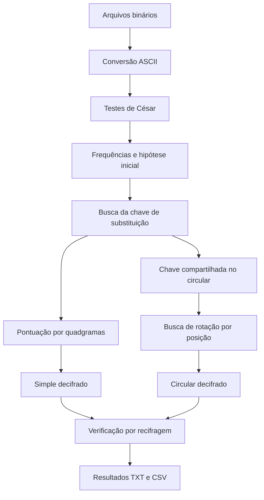

# Criptoanálise em Python

**Conversão binária · Cifras clássicas · Análise de frequência · Busca heurística de chaves**

[English](README.md) · [Metodologia](#metodologia) · [Resultados](#resultados) · [Execução](#como-executar)

Projeto da disciplina de **Arquitetura de Computadores (MCTA004-17)** da **Universidade Federal do ABC (UFABC)**. O objetivo foi recuperar duas mensagens cifradas, fornecidas em binário, e identificar as transformações aplicadas aos textos.

## Etapas da investigação



## Metodologia

| Etapa | Procedimento |
| --- | --- |
| Conversão | Leitura de blocos binários e conversão para ASCII |
| César | Avaliação dos 26 deslocamentos fixos em cada entrada |
| Frequências | Contagem de letras e reconhecimento de padrões |
| Substituição | Hill climbing com trocas aleatórias e 10 reinícios |
| Pontuação | Uso de frequências de quadgramas do inglês |
| Circular | Comparação de 1.352 combinações de rotações por posição |
| Verificação | Recifragem e comparação com as entradas convertidas |

A hipótese inicial considerou `V → T`, `C → H`, `O → E` e `T → A`. A busca automática não recebeu essas trocas como restrições.

## Resultados

| Medida | Simple | Circular |
| --- | ---: | ---: |
| Tamanho | 2.128 caracteres | 448 caracteres |
| Letras avaliadas | 1.697 | 370 |
| Candidatos avaliados | 38.259 chaves | 1.352 rotações |
| Melhor nota | −7.018,9629 | −1.526,7593 |
| Nota média por quadgrama | −4,14 | −4,16 |
| Tempo de busca em uma execução | 24,118 s | 0,590 s |
| Recifragem igual à entrada | Sim | Sim |

Oito dos dez reinícios da busca do `simple` chegaram à chave selecionada. No `circular`, a melhor transformação utilizou **início = 12**, **passo = 1**, contando somente as letras na posição. A legibilidade e a consistência entre os dois textos também sustentaram a análise; a recifragem verifica apenas a coerência das transformações inversas.

Arquivos: [resumo](resultados/10_resumo.txt) · [chave](resultados/05_simple_chave.csv) · [evolução da busca](resultados/05_simple_evolucao.csv) · [ranking de rotações](resultados/08_circular_ranking.csv).

## Organização

```text
.
├── main.py                 # Etapas da investigação
├── binario.py              # Conversão binária
├── cesar.py                # Cifra de César
├── substituicao.py         # Frequências e busca de chave
├── pontuacao.py            # Quadgramas
├── circular.py             # Rotações por posição
├── dados/
│   ├── entrada/            # Entradas cifradas
│   └── referencia/         # Frequências do idioma
├── resultados/             # Saídas TXT/CSV
├── README.md
└── README.pt-BR.md
```

## Como executar

**Requisito:** Python 3, sem dependências externas.

Na pasta principal:

```bash
python main.py
```

O programa usa os arquivos de `dados/entrada/` e a tabela de `dados/referencia/`, exibe as etapas no terminal e grava os resultados em `resultados/`. A semente aleatória 42 facilita a reprodução; o tempo varia conforme o computador.

## Limitações e referência

- Trabalho acadêmico sobre **cifras clássicas**, não uma ferramenta de segurança criptográfica moderna.
- A pontuação é heurística e depende do corpus de quadgramas em inglês.
- As métricas e os tempos descrevem uma execução específica com os arquivos fornecidos na atividade.

Tabela de quadgramas: [repositório de Lucian Buzzo](https://github.com/LucianBuzzo/simple-substitution-cipher/blob/master/english_quadgrams.txt).
